<div class="author-block">
  <div class="author-name">Rutuja Jadhav</div>
  <a href="https://rutujajadhavmail2.wixsite.com/rutujajadhav/copy-of-projects" target="_blank">
    <i class="fa-solid fa-globe"></i> Website
  </a>
  <a href="https://www.linkedin.com/in/rutuja-jadhav-b96b2aa7/" target="_blank">
    <i class="fa-brands fa-linkedin"></i> LinkedIn
  </a>
  <a href="https://github.com/rutuja-jadhav-github/Beyond-Markowitz-Optimisation-RF-GBM" target="_blank">
    <i class="fa-brands fa-github"></i> GitHub
  </a>
</div>

# Chapter 1. EDA: Insights from the Telco Customer Churn Dataset
{: .no_toc }


## 1.1 Preliminiary Observation

The dataset contains **7,043 customers and 21 attributes**. 

Initial inspection:
- All 21 variables contain 7,043 non-null observations, indicating no missing values at this stage.
- 18 categorical (`object`) variables, 2 integer variables, and 1 float numerical variable. 
- `TotalCharges` is initially stored as an `object` and therefore may require conversion to a numerical format before analysis.

<pre style="font-size: 11px; line-height: 1.35; font-family: monospace; overflow-x: auto;">
<class 'pandas.core.frame.DataFrame'>
RangeIndex: 7043 entries, 0 to 7042
Data columns (total 21 columns):
 #   Column             Non-Null Count  Dtype
---  ------             --------------  -----
 0   customerID         7043 non-null   object
 1   gender             7043 non-null   object
 2   SeniorCitizen      7043 non-null   int64
 3   Partner            7043 non-null   object
 4   Dependents         7043 non-null   object
 5   tenure              7043 non-null   int64
 6   PhoneService        7043 non-null   object
 7   MultipleLines       7043 non-null   object
 8   InternetService     7043 non-null   object
 9   OnlineSecurity      7043 non-null   object
10   OnlineBackup       7043 non-null   object
11   DeviceProtection    7043 non-null   object
12   TechSupport         7043 non-null   object
13   StreamingTV         7043 non-null   object
14   StreamingMovies     7043 non-null   object
15   Contract            7043 non-null   object
16   PaperlessBilling    7043 non-null   object
17   PaymentMethod       7043 non-null   object
18   MonthlyCharges      7043 non-null   float64
19   TotalCharges        7043 non-null   object
20   Churn               7043 non-null   object

dtypes: float64(1), int64(2), object(18)
memory usage: 1.1+ MB
</pre>

#### CAVEAT
```
Missing values were treated only before the ML modeling stage, 
so the EDA is based on 7043 records. 

There were 11 observed NaNs once `TotalCharges` was converted to numeric type. 
All with `tenure = 0`, i.e, brand-new signups with no billing history yet, not a data error. 
These 11 were dropped, bringing the dataset to **7,032 customers**. 

Moreover, `TotalCharges` itself was later dropped out of the feature space (see chpater 4) 
as it appeared to be a product of `tenure` and `MonthlyCharges`. 
Not only does this create redundancy in the feature space, but also leaks the target variable into the input.

Hence, Total Charges was inspected for EDA purposes only and thereafter ommitted completely.
```
---

## 1.2 Feature Cardinality

The number of unique values in each feature was also examined to distinguish categorical variables from continuous and identifier variables.


<pre style="font-size: 11px; line-height: 1.35; font-family: monospace; overflow-x: auto;">
<class 'pandas.core.frame.DataFrame'>
customerID          7043
gender                 2
SeniorCitizen          2
Partner                2
Dependents             2
tenure                73
PhoneService           2
MultipleLines          3
InternetService        3
OnlineSecurity         3
OnlineBackup           3
DeviceProtection       3
TechSupport            3
StreamingTV            3
StreamingMovies        3
Contract               3
PaperlessBilling       2
PaymentMethod          4
MonthlyCharges      1585
TotalCharges        6531
Churn                   2
</pre>

---
### Categorical Features 
Categorical features with low cardinality are visualised below to paint a basic picture of this customer cohort. I grouped these features into broader buckets like Demographics, Security, Payment etc for ease of comprehension. 

The cohort is split equally by gender, with majority not identifyihng as senior citizens, without depenedents. Roughly equal proportions were partnered vs not. 90% of users had a phone service. About 1 in 5 did not have internet connection. Amongst those who did, Fiber Optics had the majority share followed by DSL. Close to 50% of the cohort invested in some kind of security service such as device protection, online back up etc. More than half were enrolled on month-to-month contracts highlighting potential churn issues, whereas roughly 1/4th were registed for one-year and two-year contracts, each.

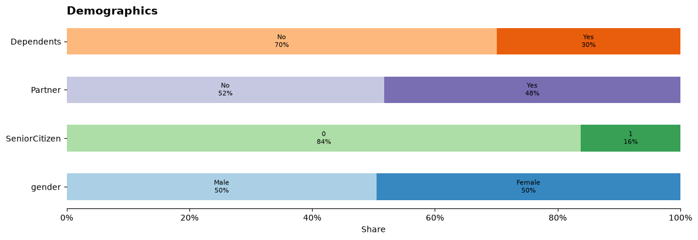
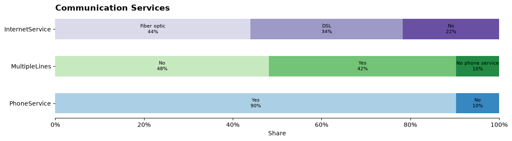
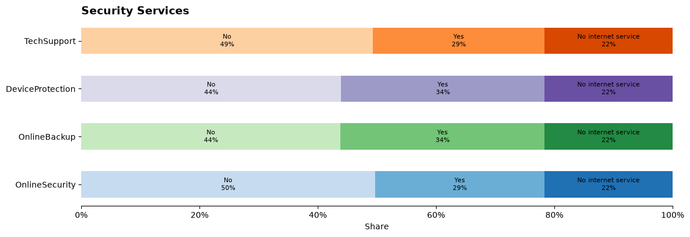
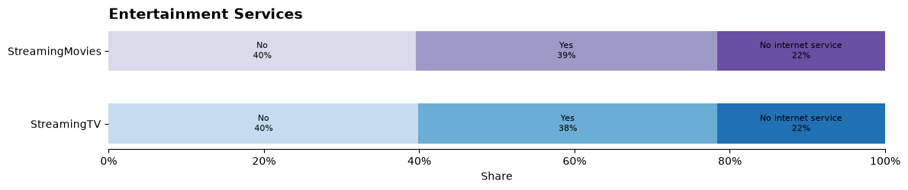
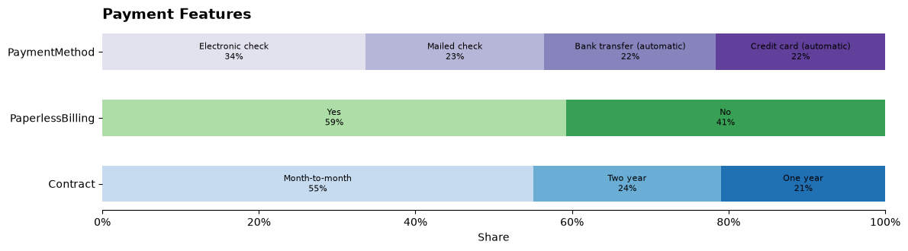

---
### Numerical Features
A frequency distribution was plotted for Total Charges, Monthly Charges, and Tenure, as these had high cardinality, almost continuous. 

#### MONTHLY CHARGES
Half the cohort paid $65 or less per month, roughly ranging from $18 $118. The histogram reveals a higher concentration around $18–20 per month, representing approximately 17% of the customer base, contributing subtanstially to the first quartile. This concentration likely reflects customers subscribed to relatively basic service packages, while charges become more broadly distributed among customers with additional services.


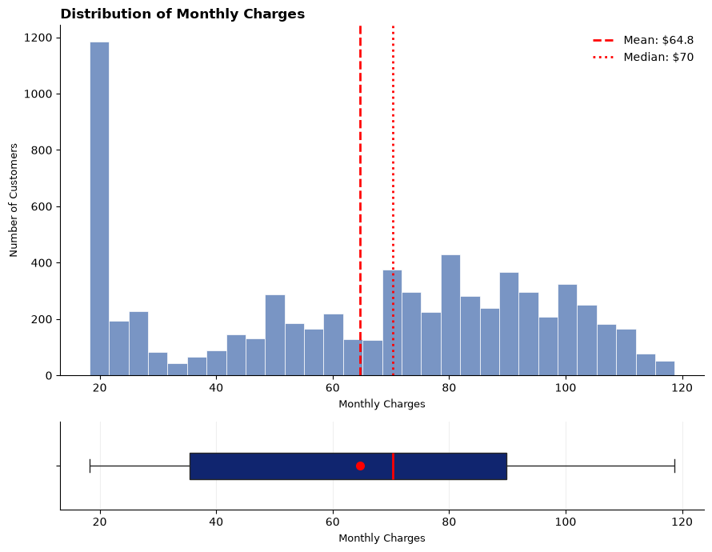

#### TOTAL CHARGES
Total charges range from $18.80 to $8,684.80, with a median of $1,397.48 and a mean of $2,283.30. The mean is substantially higher than the median, which supports the right-skewed appearance of the histogram. A relatively smaller group of long-tenure and/or high-monthly-charge customers pulls the mean upward. 25% of customers have accumulated only ~$401 or less in total charges as seen in `src/01-eda.ipynb`.

TotalCharges is largely a derived measure of tenure × monthly charges, so it is not as independent or informative as MonthlyCharges on its own.


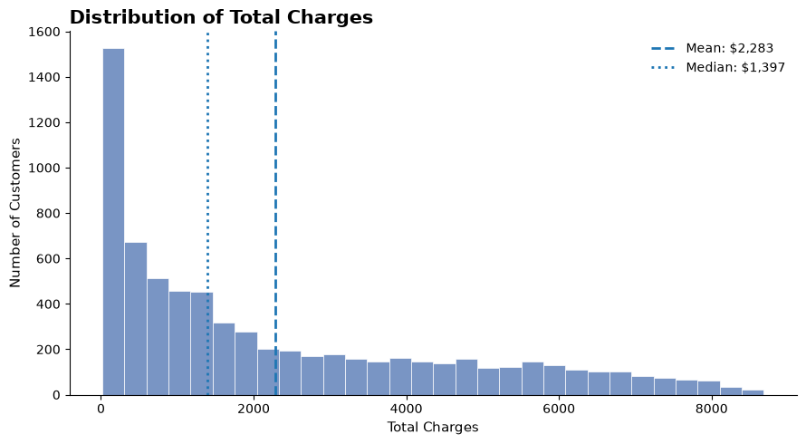

---

#### ACTIVE VS INACTIVE
26.5% of the records were not longer active customers `churn= Yes`. From an ML perspective, ---write about class imblance??

`Churn = Yes or No` was later preprocessed to `ChurnFlag = 0 or 1` to suit the modeling target space requirements

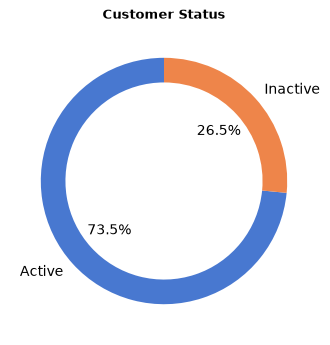

---

#### TENURE
Tenure ranges from 0 to 72 months, with an average of 32.4 months and a median of 29 months. The distribution is moderately spread, with 50% of customers having between 9 and 55 months of tenure (IQR).

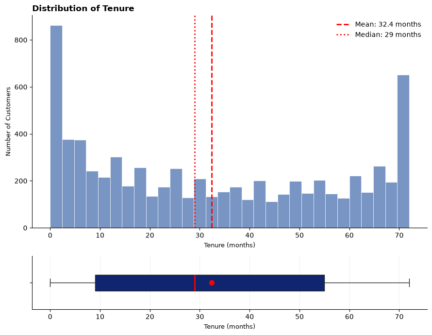

---

## 1.3 Benchmarking Tenure and Churn by category of customers

Eventually our ML model will be expected to predict cutomer churn probabilities overtime. This section is an exploratory window into what we can potentially expect in terms of which features seem to be the key drivers of churn. I grouped customers into all the available feature categories and then indexed the average tenure and average churn rate for each category against the benchmark values taken from All Customers. 

### Benchmark Index

To compare each customer category against the overall customer base, benchmark indices are calculated as:

$$
\text{Index} =
\frac{\text{Category Value}}
{\text{Overall Benchmark}}
\times 100
$$

For **Tenure Index**, the overall median tenure is used as the benchmark:

$$
\text{Tenure Index} =
\frac{\text{Category Median Tenure}}
{\text{Overall Median Tenure}}
\times 100
$$

For **Churn Index**, the overall churn rate is used as the benchmark:

$$
\text{Churn Index} =
\frac{\text{Category Churn Rate}}
{\text{Overall Churn Rate}}
\times 100
$$

An index of **100** indicates that the category is exactly at the overall
benchmark. Values **above 100** indicate over-indexing, while values
**below 100** indicate under-indexing.


The following table illustrates the Tenure and Churn Index for various customer categories (scroll all the way to the right). 

Access the full length version on `src/01-eda.ipynb`


| Feature | Category | Min | Q1 | Median | Mean | Q3 | Max | Churn % | Tenure Index | Churn Index |
|---|---|---:|---:|---:|---:|---:|---:|---:|---:|---:|
| ALL | ALL | 0.0 | 9.0 | 29.0 | 32.371149 | 55.0 | 72.0 | 26.536987 | 100.0 | 100.0 |
| gender | Female | 0 | 9.0 | 29.0 | 32.244553 | 55.0 | 72 | 26.920872 | 100.0 | 101.446602 |
| gender | Male | 0 | 9.0 | 29.0 | 32.495359 | 56.0 | 72 | 26.160338 | 100.0 | 98.580662 |
| SeniorCitizen | 0 | 0 | 9.0 | 28.0 | 32.192171 | 55.0 | 72 | 23.606168 | 96.551724 | 88.955722 |
| SeniorCitizen | 1 | 1 | 10.0 | 31.0 | 33.295972 | 56.0 | 72 | 41.681261 | 106.896552 | 157.068550 |
| Partner | No | 0 | 4.0 | 16.0 | 23.357869 | 39.0 | 72 | 32.957979 | 55.172414 | 124.196385 |
| Partner | Yes | 0 | 21.0 | 46.0 | 42.017637 | 65.0 | 72 | 19.664903 | 158.620690 | 74.103752 |
| Dependents | No | 1 | 7.0 | 25.0 | 29.806000 | 52.0 | 72 | 31.279140 | 86.206897 | 117.869977 |
| Dependents | Yes | 0 | 16.0 | 39.0 | 38.368246 | 62.0 | 72 | 15.450237 | 134.482759 | 58.221519 |
| ... | ... | ... | ... | ... | ... | ... | ... | ... | ... | ... |
| Contract | Month-to-month | 1 | 3.0 | 12.0 | 18.036645 | 29.0 | 72 | 42.709677 | 41.379310 | 160.943958 |
| Contract | One year | 0 | 27.0 | 44.0 | 42.044807 | 58.0 | 72 | 11.269518 | 151.724138 | 42.467210 |
| Contract | Two year | 0 | 48.0 | 64.0 | 56.735103 | 71.0 | 72 | 2.831858 | 220.689655 | 10.671364 |


### Tenure-Churn Index Plot

The tenure–churn index plot highlights distinct customer segments based on their relative tenure and churn behaviour. This reveals a contrast between shorter-tenure/high-churn and longer-tenure/low-churn customer segments. The most notable pattern is the contrast between the top-left quadrant (shorter tenure, higher churn) and the bottom-right quadrant (longer tenure, lower churn). 

Month-to-month customers, senior citizens, fiber-optic users, and customers without security features tend to fall into the short-tenure/high-churn quadrant, indicating greater churn vulnerability. In contrast, customers on two-year contracts and those subscribed to online security features fall into the long-tenure/low-churn quadrant, suggesting stronger customer retention. Note that any corelation however, doesn't imply causation. 

To view the interactive Plotly visualization in more detail, see `src/01-eda.ipynb`

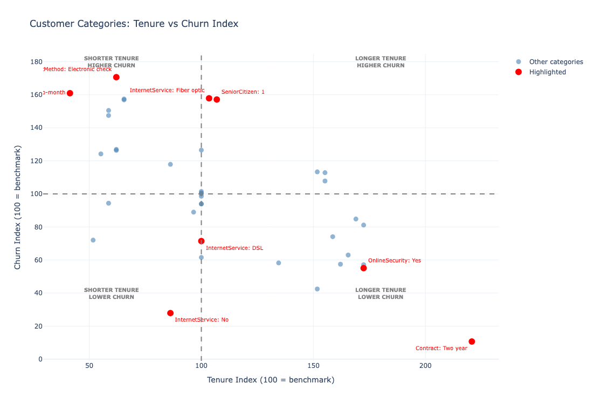


### Groups with max deivation from avg churn
All customers had an average churn of rought 1 in 4 (26.5%). Typically people on monthly contracts, using electronic checks, on fiber optic, and without any security subscriptions showed the highest negative deviation from the cohort's average churn. Whereas people yearly contracts and security services, showed the most positive deviation from average churn, ie, they were X% less likely to have a churned status as compared to the benchmark.

For instance, customers with Fiber optics had a churn rate of 58% more than the benchmark, while DSL internet users had churned 29% less than the all-customer baseline. 

Intrestingly, people with vs without partners were on the opposite ends of the spectrum, as were people with/ without dependents.

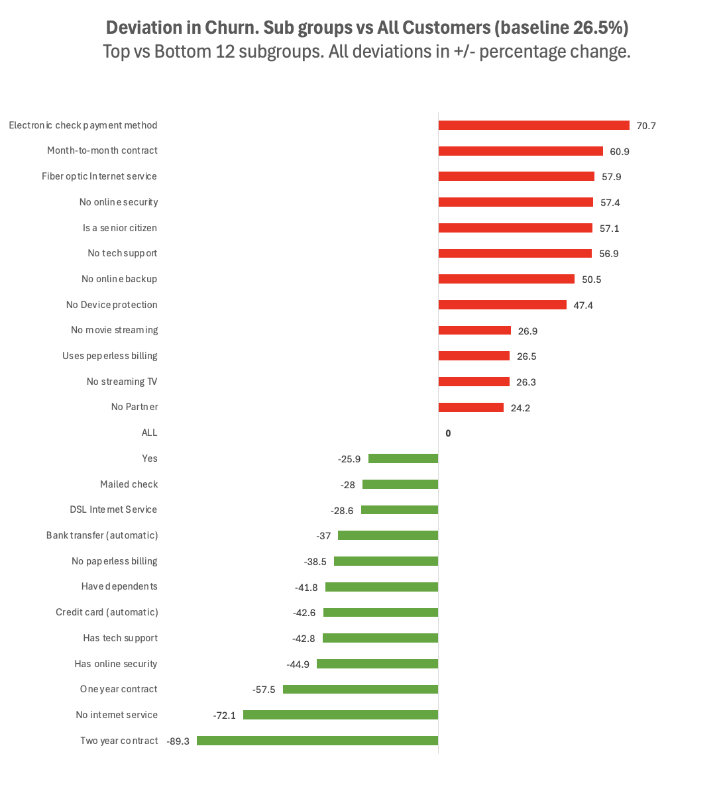


----

## 1.4 Other notable findings

### #1. Customers in familial set-ups tend to churn less than those living in individual settings.

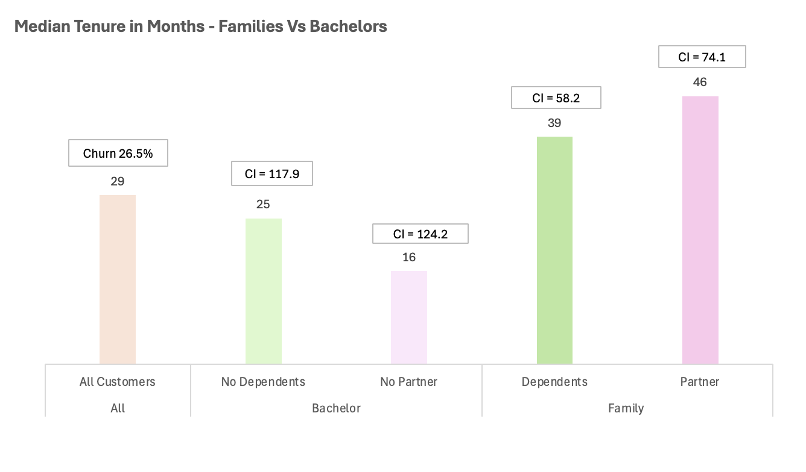

----
### #2. There seems to be some correlation between customers who survive longer and subscribe to security features.

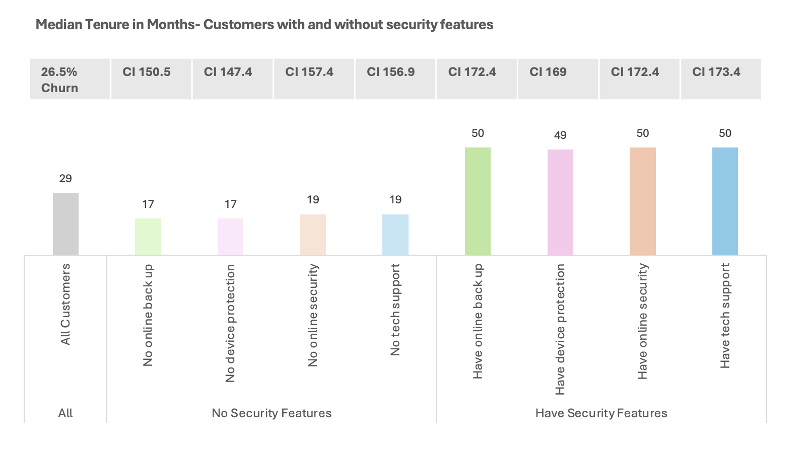

---
### #3. Subgroups with similar tenure distributions don't neccesarily have the same churn proportion.

Contrary to what one might initially expect, **similar tenure does not necessarily imply similar churn behaviour**. For example, DSL and Fiber Optic customers have broadly similar tenure distributions, yet their churn rates differ substantially (19% vs. 41%).

The reason is that **tenure tells us how long a customer has remained with the company up to the observation date; it does not tell us how much churn risk they have experienced during that period**. Two customers can both have 30 months of tenure, while having very different underlying risks of churning. In this dataset, for example, about half the DSL customers survived about 30 months with relatively few currently churning, while half of Fiber Optic customers also survived about 30 months but a much larger proportion were currently experiencing churn by the time the data was recorded.

This highlights that churn is influenced by factors beyond simply **how long a customer has been with the company** — potentially including service type, pricing, customer experience, and other correlated customer characteristics.

This is also one of the reasons **survival analysis is useful**: rather than assuming that customers with similar tenure have similar risk, it explicitly models the relationship between **time, censoring, and the occurrence of churn**.


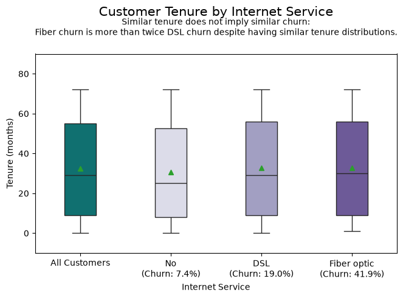

---

### #4. Dissecting tenure by contract however reveals a more intuitive churn pattern
Customers with longer contracts had substantially varying spreads compared to monthly contractors. Longer contracts had a tendency to churn less and reported longer tenures. 

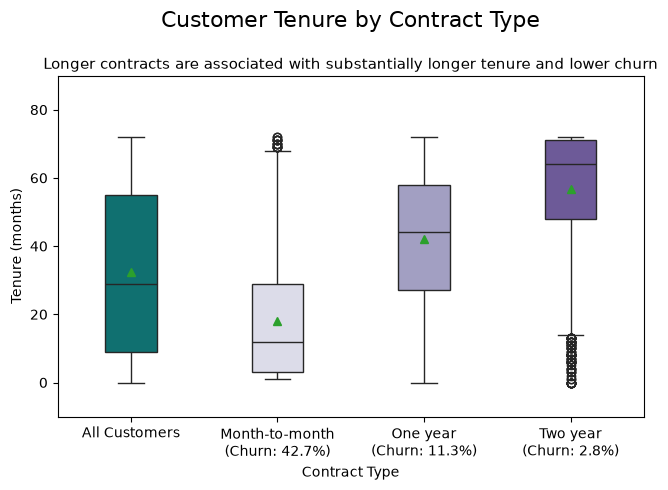

--- 