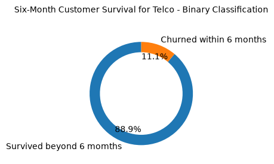
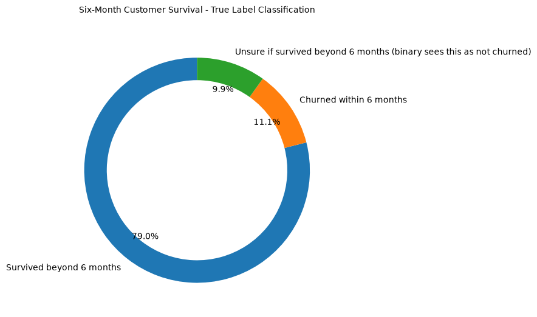
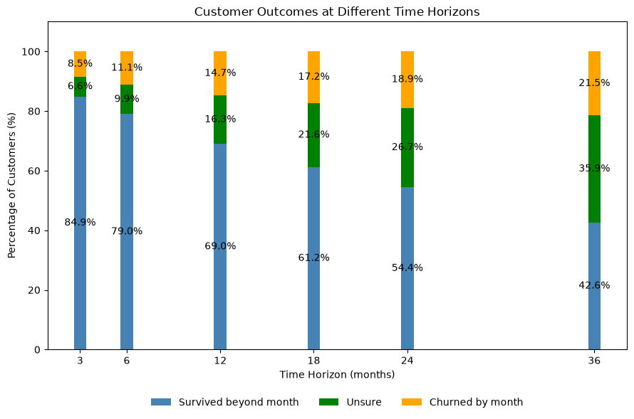
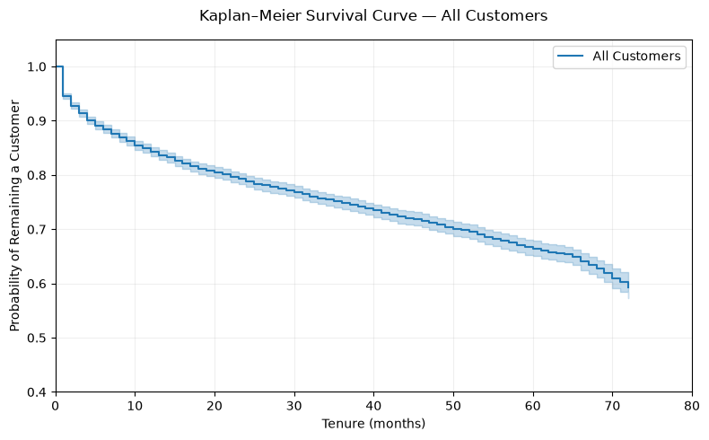
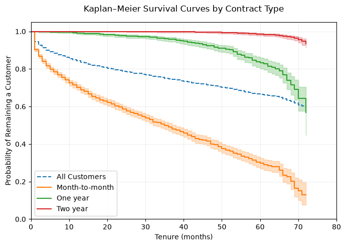
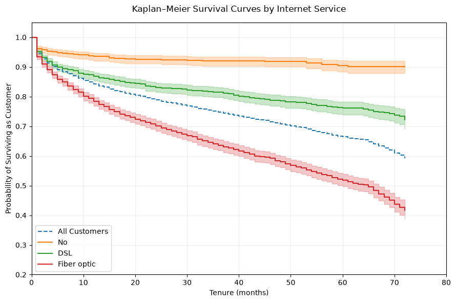

<div class="author-block">
  <div class="author-name">Rutuja Jadhav</div>
  <a href="https://rutujajadhavmail2.wixsite.com/rutujajadhav/copy-of-projects" target="_blank">
    <i class="fa-solid fa-globe"></i> Website
  </a>
  <a href="https://www.linkedin.com/in/rutuja-jadhav-b96b2aa7/" target="_blank">
    <i class="fa-brands fa-linkedin"></i> LinkedIn
  </a>
  <a href="https://github.com/rutuja-jadhav-github/Beyond-Markowitz-Optimisation-RF-GBM" target="_blank">
    <i class="fa-brands fa-github"></i> GitHub
  </a>
</div>

# Chapter 2. Survival Theory and KM Estimator
{: .no_toc }
Customer churn prediction is a canonical problem in marketing analytics, yet it is often percieved as a binary classification task — churned or not churned. This framing forces invented labels onto customers whose outcomes are still unknown, thereby artificially inflating or deflating estimated survival and corrupting model training.

To illustrate the motivation for using Survival Techniques to predict churn, let us consider an example business problem, followed by some naive solutions and see where Survvial Analysis adds value along the way.

### The Business Problem — When Does a Customer Leave?
Imagine you are a data scientist at a telecom company. Your product manager asks you two questions:

> 1. What is the average time before a customer churns?
>    If we know most customers churn around month 6, we send the retention email at month 5.
>
> 2. How many customers survive beyond month 5?
>    If survival past month 5 is low, we intervene earlier.

To answer either question you need a list of customers and when they churned.


## 2.1 Problems with naive approaches.

### 2.1.1 The Clean World: When Naive Counting Works

Consider a 12-month study of 7 customers, all of whom have churned:

#### Table 1: Clean world — all customers have churned

| Customer | Churned at Month | Status |
|:---|:---|:---|
| A | 2 | Churned |
| B | 3 | Churned |
| C | 5 | Churned |
| D | 5 | Churned |
| E | 7 | Churned |
| F | 9 | Churned |
| G | 11 | Churned |

The average churn time is

$$
\frac{2 + 3 + 5 + 5 + 7 + 9 + 11}{7} = 6 \text{ months}.
$$

The survival function at month 5 is

$$
S(5) = P(T > 5) = \frac{3}{7} \approx 0.43.
$$

This is simply the proportion of customers who churned after month 5. **No assumptions are needed.**

---

### 2.1.2 The Real World: Active Customers Break Naive Counting

In practice, not all customers have churned. Suppose customers B and E are still active:

#### Table 2: Real world — B and E are still active customers

| Customer | Tenure (months) | Status |
|:---|---:|:---|
| A | 2 | Churned |
| B | 3 | **Active** |
| C | 5 | Churned |
| D | 5 | Churned |
| E | 7 | **Active** |
| F | 9 | Churned |
| G | 11 | Churned |

Let's explore two naive options for tackling this problem, although **neither is truly fit for purpose**. Section 1.2 explains the Kaplan–Meier methodology, which overcomes the shortcomings of the techniques discussed below.

---

### Option 1: Drop Active Customers - B and E.

Computing the average churn time over only the churned customers gives

$$
\frac{2 + 5 + 5 + 9 + 11}{5} = 6.4 \text{ months}.
$$

Furthermore, the survival estimate beyond month 5 becomes

$$
S(5) = \frac{2}{5} = 0.40,
$$

since only F and G survived past month 5 (out of A,C,D,F,G).

**But B has already survived 3 months and E has survived 7 months — real survival information that belongs in the calculation**.

By dropping them, we are computing a survival estimate over an incomplete dataset. **We have no idea whether B and E are long-term loyal customers or about to churn next month.**

Dropping them loses information in an unknown direction.

---

### Option 2: Binary Classification
In this approach, we shall not drop the customers. Instead, we 'll assign everyone binary labels based on whether they have churned in our window of interest or not. i.e, 

- **If a customer churned within our window of interest, ie Tenure <= 5 months and Status is Churned**, thier class label is **Churned within 5 months** - A,C,D.
- Else, the class lable is **Not Churned within 5 months** - B,E,F, G

Therefore,

$$
S_{\text{binary}}(5)
=
\frac{B + E + F + G}{7}
=
\frac{4}{7}
\approx 0.57.
$$

Notice that while this approach **correctly identifies everyone who has surely churned within 5 months**, there is a tiny group of people it is **mislabeling as survived beyond 5 months: customers with a tenure < 5 months and Status is Active/ Non Churned**


But B has tenure = 3 months and status is not churned. **But B has not even reached month 5. So, we can't say for sure they will survive beyond 5** However, the **binary classifer model still counts B as a survivor past month 5 purely because B's label is Not Churned**.

B probably joined later and had completed only 3 months at the time our dataset for screenshot for analysis. Therefore, B might churn at month 4 or month 6 or even after 6 months— we can't say for sure.

Binary classification silently assumes that B survived past month 5 simply because their label is "Not Churned." **Time to event is not a component of the action/outcome space in binary classification, which tends to artifically inflate survival as in this case.**


---

## 2.2 Kaplan-Meier: Censoring as a solution to the naive churn estimation

### 2.2.1 Kaplan–Meier: Honest Survival Estimation

Kaplan–Meier fixes the binary labeling problem and includes **time to event** with one conceptual shift:

> **Every window of survival has three (not two) buckets of customers - Churned within window, Not Churned within window, UNSURE if churned withing window**

We call the last group **censored** — their customer journey is still unfolding.

A censored customer contributes survival information **up to their last observed month**, then exits the risk set — the pool of customers KM is watching at each time point.

They are never counted as evidence of survival **beyond what was actually observed**.

The survival function is:

$$
S(t) = P(T > t)
$$

Equivalently,

$$
S(t) = 1 - P(T \leq t).
$$

In other words:

$$
\boxed{
\text{Survival beyond }t
=
1-\text{Probability of churning by }t
}
$$

Kaplan–Meier estimates this survival probability sequentially. At each observed churn time \\(t_i\\), the fraction that survives that time is:

$$
1-\frac{d_{t_i}}{n_{t_i}},
$$

where \\(n_{t_i}\\) is the number of customers at risk just before $t_i$, and
\\(d_{t_i}\\) is the number who churn at $t_i$.

Multiplying these survival probabilities, gives us an almost conditional-like porbability where the probability of survival beyond the next window is purely conditioned on the population who has made it till that window. Anyone whose status is churned or unsure, is dropped from risk set in the next window.

$$
\boxed{
\hat{S}(t)
=
\prod_{t_i \leq t}
\left(
1-\frac{d_{t_i}}{n_{t_i}}
\right)
}
$$

#### Key survvial mechamism - Updating the At Risk pool at each timestamp
```
The mechanism that enforces the KM estimator is the **risk set** — the pool of customers
KM is actually watching at each point in time. Once a customer churns or is 
censored, they leave the risk set. They cannot inflate survival estimates for 
time points they were never observed at.
```


---
### 2.2.2 KM By Hand — S(5) Step by Step

Returning to our 7-customer example, with B (censored at month 3) and E (censored at month 7):

#### Table 3: Real world — B and E are censored

| Customer | Tenure (months) | Status |
|----------|----------------|--------|
| A        | 2              | Churned ✓ |
| B        | 3              | **Censored** i.e, Not Churned YET|
| C        | 5              | Churned ✓ |
| D        | 5              | Churned ✓ |
| E        | 7              | **Censored** i.e, Not Churned YET |
| F        | 9              | Churned ✓ |
| G        | 11             | Churned ✓ |

KM only computes a step at actual churn events — not at censoring times.
At each churn event it asks: of the customers I can still see right now,
what fraction survived this step? Then it multiplies those fractions together.

The \\(\hat{S}(t)\\) at each step is a **cumulative product of the surviving fractions up to that point** — like a funnel through which customers must survive beyond \\(t\\) months.

Recall the Kaplan–Meier estimator is:

$$
\hat{S}(t)
=
\prod_{t_i \leq t}
\left(
1 - \frac{d_{t_i}}{n_{t_i}}
\right),
$$


where:

- \\(d_{t_i}\\) is the number of churn events at time \\(t_i\\).
- \\(n_{t_i}\\) is the size of the risk set just before \\(t_i\\).


**Month 2 — A churns**

At Risk set = {A, B, C, D, E, F, G} = 7 customers
Churned = 1 (at end of month 2)
Survied = 6 (beyond month 2)

$$S(2) = \frac{6}{7} = 0.857$$

---

**Month 3 — B is censored after this**

At Risk set in month 3 = {B, C, D, E, F, G} = 6 customers
Churned = 0
Survied = 6

*Cummulative survival rate from beginning:*
$$S(3) = S(2) \times \frac{survived}{total}  = \frac{6}{7} \times \frac{6}{6} = 0.857$$

No churn event. S(t) does not step down. The curve holds flat. B exits the risk set quietly. 


This is an important distinction in calculation. Binary classification keeps B in the 'still alive pool'. KM lets B go as soon as we no longer have further information on B.

---

**Month 5 — C and D churn**

At Risk set = {C, D, E, F, G} = 5 customers. **This is where we notice the impact of labelling B as censored instead over 'not churned'. If B was labelled as 'not churned' we would have 6 cutomers at risk here.** But by labelling B as cnesored, they are taken out of the ananlysis post month 3.

Churned = 2 (C and D) left after month 5
Survived = 3

$$S(5) = S(3) \times \frac{3}{5} = \frac{6}{7} \times \frac{6}{6}\times \frac{3}{5} = \frac{18}{35} \approx 0.514$$

---


### 2.2.3 Comparing Naive Survival vs Binary Survival vs Kaplan-Meier

| Method | Who counts as survived past month 5 | S(5) |
|--------|-------------------------------------|------|
| Naive Survival | E, F, G | 3/7 = 0.43 |
| Binary Classification | B (even if tenure is only 3 months), E, F, G | 4/7 = 0.571 |
| **Kaplan-Meier** | E, F, G only | 18/35 = 0.514 |


Naive Survival and KM agree on who survived past month 5 — customers E, F, G — but arrive  at different numbers because KM accounts for the fact that B left the risk set after month 3, shrinking the denominator at every subsequent step. Naive CDF calculation is possible only if all customers have actually churned (no binary labels permitted). Therefore, its survival is also **defalted**.

Binary classification **inflated survival by keeping B** — a customer with only 3 months of tenure — in the denominator at month 5. B was never observed at month 5. B had already exited KM's risk set at month 3.

KM is more accurate because it only divides by the customers it can actually see at each moment.
> **It uses every customer's observed history, but never claims to know what happened after that observation ended.**

B contributes survival information through month 3, then leaves the risk set. E contributes survival information through month 7, then leaves the risk set. Neither customer is treated as having survived beyond what we actually observed.


---

## 2.3 Consquences on the Telco dataset

This next section takes everything we discussed in sections 1.1 and 1.2 and applies it to the actual Telco customer data. For the detailed analysis and code read please check out the src/02-binary-vs-km.ipynb notebook on the repo.

```
The central theme: binary classification only has two labels, 0 or 1. It has
no label for "we don't know yet." So every customer whose fate is genuinely
unresolved gets forcibly folded into label = 0 ("not churned") — not because
we know they're safe, but because that's the only bucket available for
"unknown." This notebook makes that fabrication visible and quantifies it,
using the real Telco dataset.
```

## 2.3.1 What binary classification actually reports: two slices, two categories

This is the naive framing a binary classifier would see — "churned" vs "not churned" — with the unknown customers silently folded into "not churned."




## 2.3.2 What's actually true: three categories, not two

Same data, same windows, but now the "Not Churned" bar is split into what's **actually confirmed** versus what's **quietly unresolved** as denoted by the green slice.



The above analysis shows reveals that X% of consumers were mislabelled in the survived bucked, thereby inflatting survival beyond six months (Y% as opposed to actual M%). If we repeat this for different time windows, we see that this chunk of 'Unsure Status' customers only keeps getting bigger, suggesting how sticking to the binary mode would have continued to artificially inflate survival.



Now we could stop right here and compute the average churn times and survival rate by segementting our data into one of the three buckets any given time window depending on our business needs. However, this would be quite inefficient, and therefore justifies the use of a KM estimator instead, whcih not only solves the censoring problem but, does so in one shot across all time windows.

### 2.3.3 KM Curve for the Telco set

Using the `KaplanMeierFitter` module from the `lifelines` library, we have a KM curve generated for the entire telco population. Notice how at each month the survvial function steps down signaling a drop in the risk set. This happens as we have no longer include the censored customers in the at risk set of the next month's window.




####. In Summary

At every window size, a real chunk of what binary classification calls "Not Churned" is not observed evidence it's every currently-active customer who simply hasn't been around long enough to clear the window yet, defaulted into "safe" purely because 0/1 has no third option. Kaplan-Meier and survival models (RSF, xgbse) treat these customers as **censored** instead contributing what's actually known (survived at least this long) without ever asserting the unknown part.


## 2.4 Limitation of the Kaplan-Meier estimator

KM gives one survival curve per population stratum or for all customers in one shot. It cannot condition on many customer features simultaneously. A month-to-month customer with high usage and long tenure is very different from a month-to-month customer who barely logs in, just as someone with DSL Internet is different from someone with fiber optics. Yet within a given stratum, KM gives these customers the same survival curve.





As we shall see in the next chapter, this limitation of KM motivates the need to condition survival on customer features, augmenting the population-level S(t) with a feature-dependent S(t∣X), where X denotes customer characteristics.

Note: Do not confuse conditioning on customer features with the conditional probabilities already present within the KM calculation. The KM estimator is built from successive probabilities of surviving each event time given that the customer has remained at risk up to that point. This is different from conditioning survival on the customer's characteristics X.


