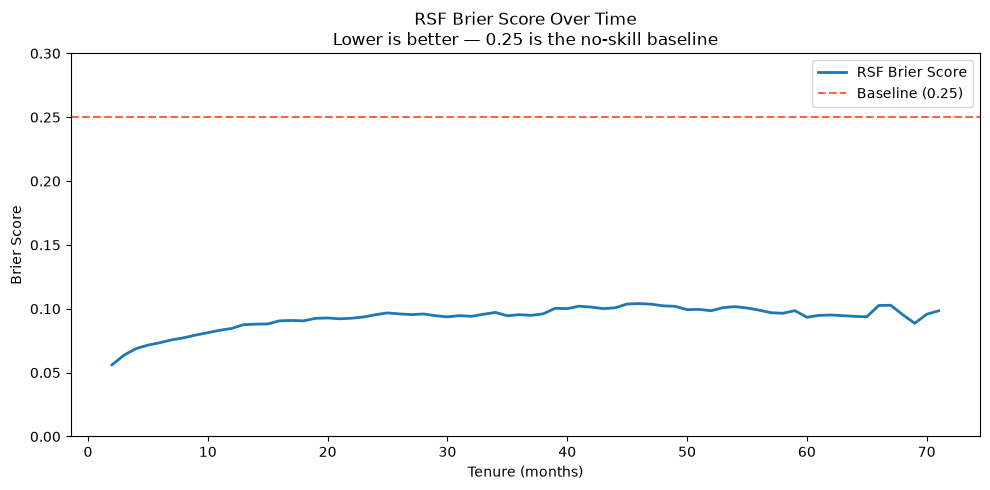
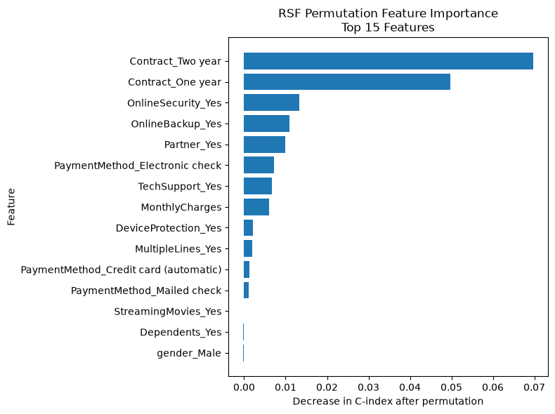
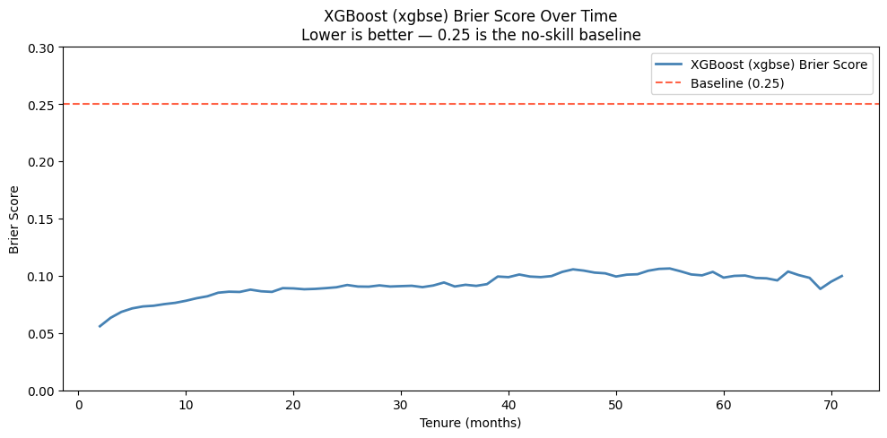

<div class="author-block">
  <div class="author-name">Rutuja Jadhav</div>
  <a href="https://rutujajadhavmail2.wixsite.com/rutujajadhav/copy-of-projects" target="_blank">
    <i class="fa-solid fa-globe"></i> Website
  </a>
  <a href="https://www.linkedin.com/in/rutuja-jadhav-b96b2aa7/" target="_blank">
    <i class="fa-brands fa-linkedin"></i> LinkedIn
  </a>
  <a href="https://github.com/rutuja-jadhav-github/Beyond-Markowitz-Optimisation-RF-GBM" target="_blank">
    <i class="fa-brands fa-github"></i> GitHub
  </a>
</div>

# Chapter 4. Ensemble Build, Comparison, and Benchmarking: RSF, XGBSE, and Kaplan-Meier
{: .no_toc }

As discussed in the previous secitons, the goal is to augment the non parametric KM curve for the Telco dataset, using Ensemble Techniques as these offer improved statiscal flexibulity in comparison to parametric alternatives like AFT and Cox Hazard Functions.

This chapter covers how the two chosen Ensemble models - Random Survival Forests (RSF) and XG Boost Survival Emebeddings (XGBSE) were built and benchmarked against the standard Kaplan-Meier Survival Curve.

## 4.1 RSF Ensemble


                              NEW CUSTOMER
                                   │
                                   │
                                   ▼
                         ┌──────────────────┐
                         │   RSF ENSEMBLE   │
                         └────────┬─────────┘
                                  │
                 Customer is sent through
                 EVERY decision tree in parallel
                                  │
              ┌───────────────────┼───────────────────┐
              │                   │                   │
              ▼                   ▼                   ▼
       ┌─────────────┐     ┌─────────────┐     ┌─────────────┐
       │ Decision    │     │ Decision    │     │ Decision    │
       │   Tree 1    │     │   Tree 2    │     │   Tree 3    │
       └──────┬──────┘     └──────┬──────┘     └──────┬──────┘
              │                   │                   │
        Bootstrap sample     Bootstrap sample     Bootstrap sample
        + random features    + random features    + random features
              │                   │                   │
              ▼                   ▼                   ▼
        ┌───────────┐       ┌───────────┐       ┌───────────┐
        │  Leaf 7   │       │  Leaf 12  │       │   Leaf 4  │
        └─────┬─────┘       └─────┬─────┘       └─────┬─────┘
              │                   │                   │
              ▼                   ▼                   ▼
        ┌───────────┐       ┌───────────┐       ┌───────────┐
        │    KM     │       │    KM     │       │    KM     │
        │  Curve 1  │       │  Curve 2  │       │  Curve 3  │
        └─────┬─────┘       └─────┬─────┘       └─────┬─────┘
              │                   │                   │
              └───────────────────┼───────────────────┘
                                  │
                                  ▼
                         ┌──────────────────┐
                         │  AVERAGE THE KM  │
                         │     CURVES       │
                         └────────┬─────────┘
                                  │
                                  ▼
                       ┌─────────────────────┐
                       │ Customer's predicted│
                       │   survival curve    │
                       │      S(t | X)       │
                       └─────────────────────┘


### 4.1.1 Data Cleaning/ Preprocessing

The dataset started as 7,043 raw customer rows from the IBM Telco churn dataset. Two things needed fixing before modeling could begin:

- **`TotalCharges` was stored as text, not a number.** Converting it to numeric revealed 11 blank rows — all with `tenure = 0`: brand-new signups with no billing history yet, not a data error. These 11 were dropped, bringing the dataset to **7,032 customers**.
- **`Churn` (Yes/No) was converted to `Churn_flag`** (1 = churned, 0 = censored/still active) — the event indicator survival analysis needs.

Resulting dataset: **26.6% churn rate**, tenure ranging from 1 to 72 months.

**`TotalCharges` was also dropped from the feature set entirely**, beyond just fixing its missing values — because it's mathematically close to `MonthlyCharges × tenure`. Since `tenure` is the actual prediction target, a feature built substantially *from* tenure would leak the target into the inputs. `tenure` itself was excluded from the features for the same, more direct reason: it *is* the label.

The final feature set: 17 raw columns, one-hot encoded (`pd.get_dummies(drop_first=True)`) into **28 numeric columns**. Target built via `sksurv`'s `Surv.from_dataframe`, producing the `(event, time)` structured array `RandomSurvivalForest` expects.

### 4.1.2 Train / validation / test split

A 70/15/15 split (`random_state=42`): **4,922 train / 1,055 validation / 1,055 test.** Three-way, not two-way, because hyperparameter tuning needed its own untouched slice — tuning against the test set would leak test information into model selection.

### 4.1.3 Hyperparameter tuning

Grid search over `n_estimators` (50/100/200/300), `max_depth` (5/8/12/None), `min_samples_leaf` (8/10/15/20) — 64 combinations, trained on train only, scored by C-index on validation only.

**Best combination: 100 trees, max depth 8, minimum 8 customers per leaf — validation C-index 0.8543.** Depth 8 beat both shallower trees (underfit) and unconstrained depth (slightly overfit); 100 trees was enough that 200–300 gave negligible further gain.

### 4.1.4 Understanding Survival Performance Metrics: C-index and IBS

**C-index** answers: *pick any two customers — does the model correctly say which is higher-risk?* It's the fraction of valid pairs the model ranks correctly. 1.0 is perfect. **0.5 is a coin flip — and not just a loose benchmark, a mathematical guarantee:** a model that predicts identically for everyone has no basis to rank anyone above anyone else, so every comparison is a tie, and ties score 0.5 by definition. C-index only checks *order*, never whether the actual probabilities are trustworthy.

**IBS (Integrated Brier Score)** answers the opposite question: *were the predicted probabilities close to what actually happened, across the whole time range?* It's the squared error between predicted and actual survival, averaged and integrated over time. Unlike C-index, it **does** penalize confidently-wrong predictions, not just bad ranking. Lower is better; 0 is perfect.

**One-line summary: C-index checks the ranking, IBS checks the numbers.**

### 4.1.5 Test set results

| Metric | Value |
|---|---|
| Test C-index | **0.8480** |
| Test IBS (months 2–71) | **0.0932** |
| Train C-index | 0.8623 |
| Train–test gap | 0.0143 |

The small train–test gap indicates healthy generalization, not memorization.



### 4.1.6 Leaf analysis

100 trees at max depth 8 (the constraint was binding — every tree reached exactly depth 8): averaging **115.2 leaves/tree** (range 85–146), **229.4 nodes/tree**. Leaf sizes: minimum 8 customers (the `min_samples_leaf` floor doing its job), **average 32.8**, and a maximum of **593 customers in a single leaf** — a large, low-diversity group, almost certainly long-tenure, stable-contract customers similar enough that no further split was ever justified.

```
=== RSF Model Parameters ===
Number of trees       : 100
Maximum depth         : 8
Minimum samples leaf  : 8
Number of features    : 28

=== Tree Structure ===
Average leaves per tree : 115.2
Minimum leaves per tree : 85
Maximum leaves per tree : 146
Average depth           : 8.0
Minimum depth           : 8
Maximum depth           : 8
Average nodes per tree  : 229.4

=== Leaf Size Analysis ===
Minimum customers per leaf : 8
Average customers per leaf : 32.8
Maximum customers per leaf : 593

```

### 4.1.7 Feature importance

`scikit-survival`'s RSF doesn't expose impurity-based importance, so **permutation importance** was used instead: shuffle one feature, measure the C-index drop. 

> The stand-out features iterated the same story we saw in the EDA - users with longer contracts, security features, in partnered/ familial set-ups using electronic payment are correlated with longer survival, lower churn.

**Contract type dominated** — `Contract_Two year` alone accounted for ~7 points of C-index when shuffled, `Contract_One year` close behind — followed at much smaller scale by `OnlineSecurity`, `OnlineBackup`, `Partner` status, and `PaymentMethod` (Electronic check). (A potential alternate for feat imp could have been SHAP values, but that wasn't really the focus of this assignment).

*Caveat: permutation importance can understate a feature's true importance when features are correlated (a correlated feature partly "covers" for the shuffled one) — `MonthlyCharges` and `Contract` type plausibly interact here, so the size of the gap should be read with that in mind, not the overall ranking.*

=== Top 15 Important Features ===


| Feature | Importance (point drop in C-index if absent)| Std |
|---|---:|---:|
| Contract_Two year | 0.069782 => 7 decimal points drop in c-index if left out | 0.009119 |
| Contract_One year | 0.049807 | 0.006679 |
| OnlineSecurity_Yes | 0.013368 | 0.001884 |
| OnlineBackup_Yes | 0.010961 | 0.002547 |
| Partner_Yes | 0.009928 | 0.002466 |
| PaymentMethod_Electronic check | 0.007195 | 0.002923 |
| TechSupport_Yes | 0.006764 | 0.002072 |
| MonthlyCharges | 0.005935 | 0.001446 |
| DeviceProtection_Yes | 0.002188 | 0.001003 |
| MultipleLines_Yes | 0.001966 | 0.001010 |
| PaymentMethod_Credit card (automatic) | 0.001224 | 0.000781 |
| PaymentMethod_Mailed check | 0.001103 | 0.000548 |
| StreamingMovies_Yes | -0.000136 | 0.000450 |
| Dependents_Yes | -0.000258 | 0.000602 |
| gender_Male | -0.000307 | 0.000445 |





---


## 4.2 XGBSE Ensemble

                              NEW CUSTOMER
                                   │
                                   ▼
                         ┌──────────────────┐
                         │      XGBSE       │
                         │ Kaplan Neighbors │
                         └────────┬─────────┘
                                  │
                                  ▼
                    ┌─────────────────────────┐
                    │ STAGE 1: XGBoost AFT    │
                    └────────────┬────────────┘
                                 │
                                 ▼
                       ┌────────────────────┐
                       │ Candidate split    │
                       │                    │
                       │ Feature + threshold│
                       │        ↓           │
                       │   2 child nodes    │
                       └─────────┬──────────┘
                                 │
                                 ▼
                    ┌──────────────────────────┐
                    │     AFT OBJECTIVE        │
                    │                          │
                    │  Does this split improve │
                    │  the negative AFT log.   |
                    |  likelihood?             |
                    │                          │
                    │  Uses (T, δ)             │
                    │  • T = tenure            │
                    │  • δ = churn/censoring   │
                    │                          │
                    │  AFT models log(T)       │
                    └────────────┬─────────────┘
                                 │
                                 │ Best improvement
                                 ▼
                    ┌──────────────────────────┐
                    │      TREE IS BUILT       │
                    │                          │
                    │ Repeat splitting         │
                    │ → boosted trees          │
                    └────────────┬─────────────┘
                                 │
                                 ▼
                    ┌──────────────────────────┐
                    │ TREE-BASED REPRESENTATION│
                    │                          │
                    │ Customer's leaf position │
                    │ across all trees         │
                    └────────────┬─────────────┘
                                 │
                                 ▼
                    ┌──────────────────────────┐
                    │   FIND NEAREST           │
                    │   CUSTOMERS              │
                    │                          │
                    │ e.g. n_neighbors = 30   │
                    └────────────┬─────────────┘
                                 │
                                 ▼
                    ┌──────────────────────────┐
                    │ Survival histories       │
                    │ of 30 neighbours         │
                    │                          │
                    │        (T, δ)            │
                    └────────────┬─────────────┘
                                 │
                                 ▼
                         ┌───────────────┐
                         │ Kaplan-Meier  │
                         └───────┬───────┘
                                 │
                                 ▼
                         ┌────────────────┐
                         │   S(t | X)     │
                         └────────────────┘

Same data, same preprocessing, and the same exact 70/15/15 split (`random_state=42`) as the RSF section. Everything below covers what's different about building this model.

### 4.2.1 Why `xgbse`, not raw XGBoost

Plain XGBoost's survival objectives (`survival:cox`, `survival:aft`) only output a risk score or a point time estimate — not a full survival curve, which makes them awkward to compare against RSF's curve-based output. **`xgbse` (XGBoost Survival Embeddings)** wraps XGBoost with a Kaplan-Meier-based estimator so `.predict()` returns a full survival curve, directly comparable to RSF's. The specific variant used, **`XGBSEKaplanNeighbors`**, works conceptually close to RSF too: it finds nearest neighbors in XGBoost's learned feature space and runs Kaplan-Meier over each neighborhood — the same "group-level KM inside a learned partition" idea as RSF's leaves, just built on boosted trees instead of bagged ones.

### 4.2.2 An extra check RSF didn't need - tenure's distribution

XGBoost's AFT (Accelerated Failure Time) objective assumes tenure follows a specific parametric distribution, so before training, the shape of `log(tenure)` was examined to sanity-check that assumption — a step with no equivalent in RSF, which makes no distributional assumption at all. Three candidate distributions were compared directly on validation C-index: **normal performed best** (0.863), followed by extreme (0.855) and logistic (0.849).

### 4.2.3 Hyperparameter tuning

A grid search over boosting rounds (100/200), max tree depth (3/5), learning rate (0.05/0.1), and neighborhood size (30/50) — 16 combinations, trained on the training set only, scored by C-index on validation only, mirroring the same train-only-fit, validation-only-score discipline used for RSF.

**Best combination: 100 boosting rounds, max depth 5, learning rate 0.1, 50 neighbors, normal AFT distribution — validation C-index 0.8633.**

### 4.2.4 Test set results

| Metric | Value |
|---|---|
| Test C-index | **0.8471** |
| Test IBS (months 2–71) | **0.0923** |
| Train C-index | 0.8692 |
| Train–test gap | 0.0221 |

IBS was evaluated on the identical month-by-month time grid as RSF's, which matters for the comparison in Part 4 — both models' calibration is being read off the exact same points in time, not just a similar range.



---

## 4.3 Kaplan-Meier as the benchmark

Both models above need a floor to compare against — the weakest reasonable model — to know whether 0.85-ish C-index and ~0.09 IBS are actually good, or just "good for this dataset regardless of model."

**Population-level Kaplan-Meier is that floor:** one single survival curve, fit with **zero features**, given identically to every customer regardless of who they are. It's the direct answer to *"what would we predict if we didn't condition on any customer characteristics at all?"*

This makes it a uniquely clean benchmark for two reasons:

1. **Its C-index is guaranteed, not just typically, to be exactly 0.5.** Since every customer gets an identical prediction, there's no basis to rank anyone above anyone else — every pairwise comparison is a tie, and ties score 0.5 by definition of concordance. This isn't an empirical result; it's a structural fact of giving a model zero discriminative information.
2. **Its IBS is *not* a fixed theoretical number** — unlike a common rule-of-thumb of "0.25 for an uninformative guess" (which is the ceiling for a constant 50% prediction, not what a real KM curve fit to real data actually produces). The real number has to be computed.

Fit on the same train+val data as both models, evaluated on the same test set and the same time grid, for a genuinely fair three-way comparison:

| Metric | Value |
|---|---|
| Test C-index | **0.5000** (structural, as expected) |
| Test IBS | **0.1760** |

The real KM IBS (0.176) sits meaningfully below the mythical 0.25 "ceiling," because the dataset's actual 26.6% churn rate pulls the curve away from the least-informative 50% guess — but it's still nearly double both models' IBS, which is exactly the gap a working model needs to justify existing.

---

## 4.4 Full comparison - KM (naive baseline), RSF, XGBSE

All three models evaluated on the identical test set, identical time grid, and identical underlying `sksurv` metric functions (`concordance_index_censored`, `integrated_brier_score`) — genuinely comparable, not just three separately-reported numbers.

| Model | Train C-index | Test C-index | Test IBS |
|---|---|---|---|
| Population Kaplan-Meier (no features) | 0.5000* | 0.5000 | 0.1760 |
| Random Survival Forest | 0.8623 | **0.8480** | **0.0932** |
| XGBoost (xgbse) | 0.8692 | 0.8471 | 0.0923 |

*\*KM's train C-index is 0.5000 for the same structural reason as its test C-index — identical predictions guarantee ties regardless of which split is checked, so it isn't a separately meaningful computation. KM's train IBS was not computed, since IBS is reported specifically to describe test-set (unseen-data) calibration, not to diagnose overfitting the way a train-vs-test comparison does, for which we used c-index in the HP tuning.*

**Conclusion from the table:** 
1. Both models surpass the KM floor decisively — roughly 35 C-index points above the coin-flip line, and IBS cut nearly in half. 2. Between RSF and XGBoost specifically, the two are close enough to call a statistical tie: RSF edges ahead on both metrics by a tiny margin (C-index 0.8480 vs 0.8471, a 0.0009 gap; IBS 0.0932 vs 0.0923, similarly a 0.0009 gap in XGBoost's favor) — both differences are noise-level, not a meaningful performance gap either way. 
3. XGBoost's train-test C-index gap (0.8692 → 0.8471, a 0.022 drop) is somewhat larger than RSF's (0.8623 → 0.8480, a 0.014 drop), a mild signal of slightly more overfitting in XGBSE, though not dramatic. 

> Modeling choice between the two therefore, comes down to secondary factors — interpretability, training speed, deployment simplicity — rather than a clear predictive-performance winner. **For the rest of the project, ie - system design/ app deployment, I chose to process with RSF as my final choice of the underlying model**, despite its slightly lower c-index, as it fared well on other key modeling aspects - lesser overfitting, more interpretability, and more non-parametric style flexibility as a result of not having to deal with any parametric loss objective, unlike XGBSE which works on the AFT log likelihood following a certain tenure distribution (4.2.2).

