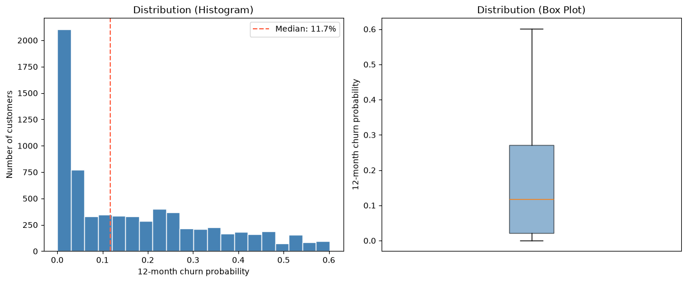

<div class="author-block">
  <div class="author-name">Rutuja Jadhav</div>
  <a href="https://rutujajadhavmail2.wixsite.com/rutujajadhav/copy-of-projects" target="_blank">
    <i class="fa-solid fa-globe"></i> Website
  </a>
  <a href="https://www.linkedin.com/in/rutuja-jadhav-b96b2aa7/" target="_blank">
    <i class="fa-brands fa-linkedin"></i> LinkedIn
  </a>
  <a href="https://github.com/rutuja-jadhav-github/Beyond-Markowitz-Optimisation-RF-GBM" target="_blank">
    <i class="fa-brands fa-github"></i> GitHub
  </a>
</div>

# Chapter 5. Pre-depolyment Application Analysis: sorting customers into appropriate risk buckets
{: .no_toc }

## 5.1 Objective

The end goal of this project is a deployable application built around rsf_final_model, offering two modes of use:

* Mode A — Batch analysis: upload a CSV of customers, set a churn probability threshold based on business requirements and a time window, and get back the customers to target for a retention campaign.

* Mode B — Single customer: enter one customer's details and receive a Low/Medium/High risk classification, along with a survival curve plotted against reference examples of what a customer in each risk tier typically looks like.

**Mode B's reference curves require identifying a representative real customer for each risk tier — not a hypothetical profile, but an actual customer from the data whose predicted risk sits near the middle of that tier's range. Before that's possible, the risk tiers themselves need to be defined.**


## 5.2 Defining the risk measure

To construct the risk tiers, the final RSF model was applied to the complete dataset of 7,032 customers (justified at the end of this section). For each customer, the model produced an individual survival curve, $S(t \mid X)$.

A **12-month horizon** was then selected. The customer's predicted probability of churn by month 12 was calculated as:

$$
P(T \leq 12 \mid X) = 1 - S(12 \mid X)
$$

This produces one churn-probability score for every customer. 

A predicted churn probability represents the probability that a customer will churn within a specific time horizon. For example, a 5% 12-month churn probability can be intuitively understood as: out of 100 customers with a similar estimated risk, roughly 5 would be expected to churn within the next 12 months.

This is a probability, not a population percentage. It describes an individual customer's estimated risk, whereas a population percentage describes how many customers belong to a particular group.

There are therefore two distinct levels of analysis:

1. **Individual level:** each customer receives a predicted 12-month churn probability expressed as a percentage.
2. **Population level:** the distribution of these individual probabilities is examined across all 7,032 customers.

**The second layer is what allows the risk bands to be defined in this chapter**

## 5.3 Examining the probability distribution

Before assigning customers to Low, Medium, or High risk, the distribution of predicted 12-month churn probabilities was examined using summary statistics, probability bands, and visualizations.

The probabilities were first grouped into bands such as:

- 0–10%
- 10–20%
- 20–30%
- 30–40%
- 40–50%
- 50–60%
- 60–70%
- etc.

The number and percentage of customers falling into each band were then calculated.

This step was important because the risk thresholds should reflect the probabilities that the model actually produces. For example, simply declaring **60%+ as "High Risk"** would be unhelpful if almost no customers ever receive a predicted probability that high. Examining the distribution first prevents arbitrary thresholds from creating empty or meaningless risk categories.

```
12-month churn probability distribution:
  Min:    0.0%
  Mean:   16.8%
  Median: 11.7%
  Max:    60.2%

Quartiles:
  Q1 (p25): 2.2%
  Q2 (p50): 11.7%
  Q3 (p75): 27.1%

12-month churn probability, by band:
      0% - 10% :  3310 customers  (47.1%)
     10% - 20% :  1093 customers  (15.5%)
     20% - 30% :  1073 customers  (15.3%)
     30% - 40% :   676 customers  (9.6%)
     40% - 50% :   525 customers  (7.5%)
     50% - 60% :   354 customers  (5.0%)
     60% - 70% :     1 customers  (0.0%)
     70% - 80% :     0 customers  (0.0%)
     80% - 90% :     0 customers  (0.0%)
    90% - 100% :     0 customers  (0.0%)

```



## 5.4 Establishing the Low / Medium / High risk tiers 

The observed probability distribution was then used to define three populated risk bands:

- **Low Risk:** customers with the lowest predicted probability of churn within 12 months. *Set here as < 10%*
- **Medium Risk:** customers with an intermediate predicted probability of churn within 12 months. *Set here as 10% < P < 30%*
- **High Risk:** customers with the highest predicted probability of churn within 12 months. *Set here as P >30%*

*These thresholds are intended as **business-facing categories**, rather than additional model parameters, and can therefore be changed from model.py as per evolving business requirements*. 

The RSF produces the underlying probability; the risk bands provide a simpler way for a business user to interpret and act on that probability.

## 5.5 Building the Reference Profiles

Reference profiles were created from the **individual survival predictions generated by the RSF model**, rather than from a single population-level Kaplan–Meier curve. For each of the ~7,032 customers, the RSF produced a personalized survival curve, from which we calculated their predicted probability of churn at 12 months, (1-S(12)).

We then grouped customers into **Low (<10%), Medium (10–30%), and High (≥30%) risk** based on their individual predicted probabilities. Within each risk group, we selected a real customer whose predicted probability was closest to the group median to serve as the reference profile.

This distinction is important: a population-level Kaplan–Meier curve does not use customer features and therefore produces the **same survival estimate for everyone**. It would not provide meaningful individual risk segmentation. The reference profiles therefore represent **real customers and their model-predicted risk**, making them more useful for illustrating what each risk segment looks like in practice.


Once the bands were established, actual customers falling within each band could be identified. **A representative customer from each tier can then be selected to provide the reference survival curves used in Mode B of the application.**

> IMPORTANT! Each Low/Medium/High reference customer is a real individual whose 12-month churn probability falls near the middle of that band — not a "typical curve" for the tier. **Two customers in the same bucket can reach a similar 12-month probability via very different paths (a steep early drop vs. a slow steady decline), and their curves can even cross, depending on their features**.


```
REFERENCE_PROFILES = {
    "Example: Low risk": {  # actual 12-month churn prob: 1.9%
        "gender": "Female",
        "SeniorCitizen": 0,
        "Partner": "No",
        "Dependents": "No",
        "PhoneService": "Yes",
        "MultipleLines": "No",
        "InternetService": "No",
        "OnlineSecurity": "No internet service",
        "OnlineBackup": "No internet service",
        "DeviceProtection": "No internet service",
        "TechSupport": "No internet service",
        "StreamingTV": "No internet service",
        "StreamingMovies": "No internet service",
        "Contract": "Two year",
        "PaperlessBilling": "Yes",
        "PaymentMethod": "Bank transfer (automatic)",
        "MonthlyCharges": 20.75,
    },
    "Example: Medium risk": {  # actual 12-month churn prob: 19.9%
        "gender": "Female",
        "SeniorCitizen": 0,
        "Partner": "No",
        "Dependents": "Yes",
        "PhoneService": "Yes",
        "MultipleLines": "No",
        "InternetService": "DSL",
        "OnlineSecurity": "No",
        "OnlineBackup": "No",
        "DeviceProtection": "No",
        "TechSupport": "Yes",
        "StreamingTV": "Yes",
        "StreamingMovies": "Yes",
        "Contract": "Month-to-month",
        "PaperlessBilling": "Yes",
        "PaymentMethod": "Credit card (automatic)",
        "MonthlyCharges": 69.4,
    },
    "Example: High risk": {  # actual 12-month churn prob: 41.7%
        "gender": "Male",
        "SeniorCitizen": 1,
        "Partner": "Yes",
        "Dependents": "No",
        "PhoneService": "Yes",
        "MultipleLines": "Yes",
        "InternetService": "Fiber optic",
        "OnlineSecurity": "No",
        "OnlineBackup": "No",
        "DeviceProtection": "No",
        "TechSupport": "No",
        "StreamingTV": "No",
        "StreamingMovies": "No",
        "Contract": "Month-to-month",
        "PaperlessBilling": "Yes",
        "PaymentMethod": "Electronic check",
        "MonthlyCharges": 74.4,
    },
}
```

These customers were then manually coded in Mode B of model.py as the reference customers to be plotted along side the KM curve of a new test customer. The new customer's KM curve can then be benchmarked against the KM curves of a typical/ random low - medium - high risk customer's KM curve.


## 5.5 Justifications and Caveat

1. The decision of splitting customers into low/ medium/ high churn risk AFTER the model has predicted their probaiility of churn/survival by time T, is a Business Decision. If this were a modeling decision, for example if this affected our choice of hyper params, then we would have to be cautious about which 'X' - train, test or val, to use for this analysis. Right now all we needed for was the largest population available to us that could help us visualise the fraction of customers available in each P(Churn) bank and then assign them to low/med/high risk brackets.

2. A 12-month horizon was selected as the common reference point for this analysis. This provides a simple annual measure of churn risk that can be used consistently across customers and is naturally aligned with business planning, contracts, retention campaigns, and annual customer-management cycles. The same framework can later be extended to other horizons if required. For example, the batch application could allow a business user to specify a different time window depending on the retention campaign being considered.


3. Reference profiles represent a single customer from that tier, not the whole tier. Each Low/Medium/High reference customer is a real individual whose 12-month churn probability falls near the middle of that band — not a "typical curve" for the tier. **Two customers in the same bucket can reach a similar 12-month probability via very different paths (a steep early drop vs. a slow steady decline), and their curves can even cross, depending on their features**. A natural future app improvement would be plotting several real customers per band to show the actual spread, or using a proper functional average (e.g. the mean curve across all customers in that band) instead of a single representative individual.

3. Caveat worth noting: since roughly 85% of this population was also used to fit the model, predicted probabilities on those rows may be marginally more confident than on genuinely unseen customers. This is an acceptable limitation for a policy-calibration exercise, though it would be inappropriate if this population were being used to claim model performance.

