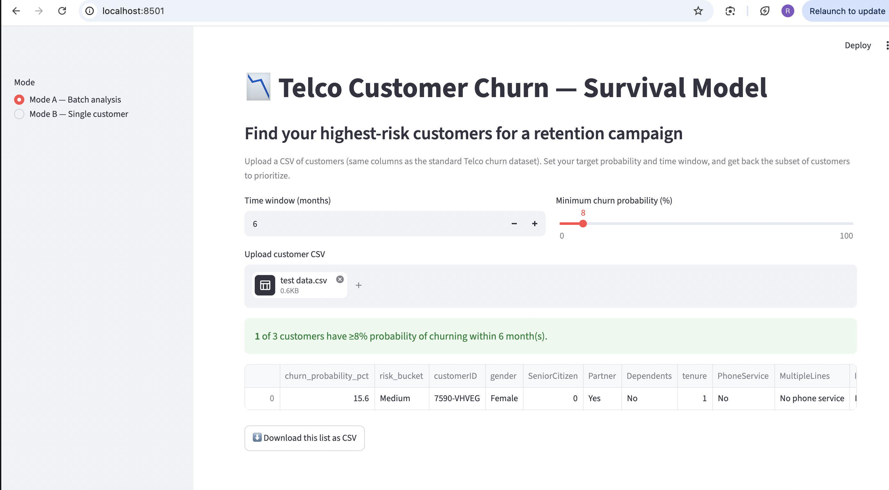
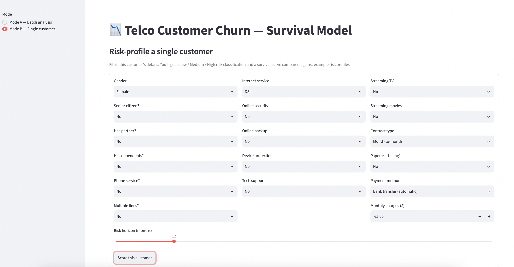
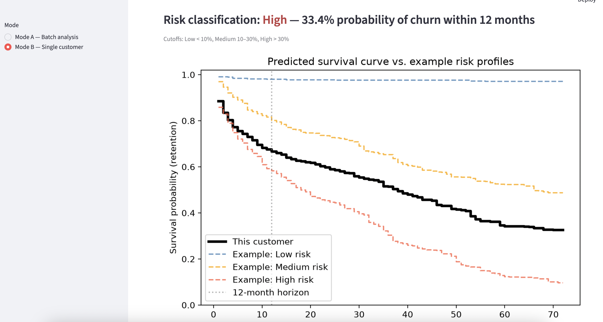
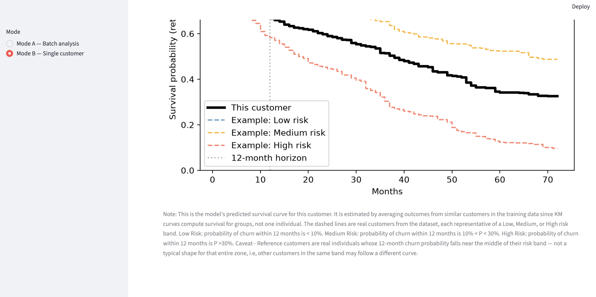

<div class="author-block">
  <div class="author-name">Rutuja Jadhav</div>
  <a href="https://rutujajadhavmail2.wixsite.com/rutujajadhav/copy-of-projects" target="_blank">
    <i class="fa-solid fa-globe"></i> Website
  </a>
  <a href="https://www.linkedin.com/in/rutuja-jadhav-b96b2aa7/" target="_blank">
    <i class="fa-brands fa-linkedin"></i> LinkedIn
  </a>
  <a href="https://github.com/rutuja-jadhav-github/Beyond-Markowitz-Optimisation-RF-GBM" target="_blank">
    <i class="fa-brands fa-github"></i> GitHub
  </a>
</div>

# Chapter 6. ML Deployment: App design, API build, Docker and Containerization.
{: .no_toc }

This chapter walks through the different stages I explored to take the trained survival model, confined to a jupyter notebook, to a more real-life application that could work anywhere, as a real service.

---

## Stage 0: Saving the trained model

Before building an application, the trained RSF needed to be separated from the notebook in which it was developed. The purpose of this step was simple: the application should not have to retrain the model every time it starts.

The .pkl file contains the already-trained Random Survival Forest, including its learned trees and parameters. The application can therefore load the model and immediately use it to generate predictions for new customers.

The final model was serialized using `joblib`:

```python
import joblib

joblib.dump(rsf_final, "rsf_final_model.pkl")
```

This produced rsf_final_model.pkl

The notebook is responsible for training and evaluating the model. The deployed application is responsible for loading that finished model and using it to make predictions.

---

## Stage 1: Streamlit UI and model loading+prediction logic

#### Pieces: rsf_final_model.pkl, model.py, app.py, Streamlit.

The first working version was deliberately simple: one Python application.

model.py contained the model-loading and prediction logic, while app.py used Streamlit to collect customer information and display the predictions.

The architecture was:


                    customer features
                           │
                           ↓
                  ┌──────────────────┐
                  │   Streamlit UI   │
                  └────────┬─────────┘
                           │
                    prediction request
                           ↓
                  ┌──────────────────┐
                  │    model.py      │
                  │                  │
                  │   RSF model      │
                  └────────┬─────────┘
                           │
                    prediction
                           ↓
                  ┌──────────────────┐
                  │   Streamlit UI   │
                  └──────────────────┘
                           │
                           ↓
                     Result shown
                     to the user


The main concept introduced here was model serving.

The trained model no longer lives only inside the notebook. It has become an artifact that can be loaded by another program and used to generate predictions.

I also learned to separate the model logic from the UI logic. Streamlit handles what the user sees and enters; model.py handles loading the model and producing predictions.

At this point, however, the model is still accessed directly by the Streamlit application.

That leads to the next question:

What if something other than Streamlit needs to use the model?

---

## Stage 2: Adding an API between the UI and the model

#### New piece: api.py, using FastAPI.

The next step was to introduce an API layer between the user interface and the model.

The important point is that the API does not replace the existing Streamlit → model pathway. Instead, it inserts a standardized communication layer between them.


Why introduce an API?

The important change is that the model is no longer tied to the Streamlit application.

Streamlit is now simply one client of the API.

The same API could also be called by another front end, python program, etc. It gives the model a standardized interface that other applications can communicate with.

As deployment is not my forte, this stage was quite exciting as it introduced several concepts:

- API: an interface through which another program can request a service.
- HTTP: the communication mechanism used to send requests and receive responses.
- REST-style endpoints: a common way of organizing HTTP-based APIs around resources and operations.
- FastAPI: the Python framework used to build the API.
- Request/response architecture: the client sends data, the server processes it, and the server returns a response.

### The REST API layer

The FastAPI application exposes the model through HTTP endpoints. These
endpoints define a formal interface between the client — in this case,
Streamlit — and the prediction service.

For this application, two prediction endpoints were defined:

```text
POST /predict - accepts the feature values for a single customer and returns that customer's prediction.
POST /predict_batch - accepts a collection of customers and returns predictions
for the entire batch.
```
The endpoints use the HTTP POST method because customer features are being sent to the server in the request body. This is different from a GET request, which is conventionally used to retrieve an existing resource without sending a new prediction payload.

#### MODE - single customer analysis
```
Streamlit or any other front end
   │
   │ POST /predict
   │
   │ {
   │   customer features
   │ }
   ↓
FastAPI
   │
   │ validate request
   ↓
RSF model
   │
   │ prediction
   ↓
FastAPI
   │
   │ HTTP 200 response
   │
   │ {
   │   prediction results
   │ }
   ↓
Streamlit or any other front end
```

#### Mode - batch analysis
```
Streamlit or any other front end
   │
   │ POST /predict_batch
   │
   │ [customer 1, customer 2, ..., customer N]
   ↓
FastAPI
   │
   │ validate payload
   ↓
RSF model
   │
   │ predictions for N customers
   ↓
FastAPI
   │
   │ JSON response
   ↓
Streamlit or any other front end
```

This is the REST-style interface: the client does not need to know how the
RSF is implemented, where the .pkl file is stored, or how predictions are
calculated internally. It only needs to know which endpoint to call, which
HTTP method to use, what data to provide, and what response structure to
expect.

FastAPI is the framework used to implement this interface. It also provides
automatic validation of the incoming request against the defined schema,
meaning malformed or incomplete customer data can be rejected before it
reaches the model.


---

## Stage 3: Docker — making the environment reproducible

#### New pieces: Dockerfile.api, Dockerfile.app.

Once the API and UI were working, another problem appeared:

Will this application work on someone else's machine?

A Python application depends on much more than its .py files:
Python version, Python packages, package versions, operating system environment, application code, trained model all of which collectively contribute to a complete working application.

A Dockerfile provides a reproducible recipe for creating that environment. It allows the environment required to run the application to be specified explicitly.


Conceptually:

                    Dockerfile
                         │
                         ↓
              ┌─────────────────────┐
              │ Base environment    │
              │ Python version      │
              │ Dependencies        │
              │ Application code    │
              │ Model file          │
              └──────────┬──────────┘
                         │
                      build
                         ↓
                    Container

For this project, separate Dockerfiles were created for the API and Streamlit application:


Dockerfile.api
      ↓
API container


Dockerfile.app
      ↓
Streamlit container


The important distinction is:

Dockerfile → instructions for building the environment.
Container → a running instance of that environment.


### Limitation

A key limitation of this stage, however, was that the two services used a separate Dockerfile for each — one for the API and one for the UI/application itself. As a result, both services had to be started separately in the terminal rather than being launched together as one complete application.

```text
┌─────────────────────┐
│   UI Container      │
│                     │
│     app.py          │
│     Streamlit       │
└──────────┬──────────┘
           │
           │ HTTP
           ↓
┌─────────────────────┐
│   API Container     │
│                     │
│     api.py          │
│       ↓             │
│     model.py        │
│       ↓             │
│ rsf_final_model.pkl │
└─────────────────────┘
```

---

## Stage 4: Docker Compose — running the application as multiple services

#### New piece: docker-compose.yml.

So far the application consists of two services:

```
┌──────────────────┐
│  Streamlit UI    │
└────────┬─────────┘
         │
         │ HTTP request
         ↓
┌──────────────────┐
│   FastAPI API    │
└────────┬─────────┘
         │
         │ model call
         ↓
┌──────────────────┐
│    RSF Model     │
└──────────────────┘
```

These services need to run at the same time and communicate with each other.

**Rather than starting and configuring them manually, docker-compose.yml describes how the services should run together.**

Conceptually:

                    docker-compose.yml
                           │
             ┌─────────────┴─────────────┐
             │                           │
             ↓                           ↓
     ┌───────────────┐           ┌───────────────┐
     │ UI Container  │ ──HTTP──→ │ API Container │
     │               │ ←──────── │               │
     │  Streamlit    │           │    FastAPI    │
     └───────────────┘           └───────┬───────┘
                                        │
                                        ↓
                                   RSF Model

Docker Compose therefore provides a single configuration describing the application's multiple services and how they communicate.

This stage introduced multi-service orchestration with clear divison of labour:

1. Dockerfile → how to build a service.
2. Container → a running instance of that service.
3. Docker Compose → how multiple services should run and communicate together.

>The result is that the entire application can be started as a single system rather than requiring each component to be manually launched and configured.

---

## Summary

| Stage | New problem | Concept introduced |
|---|---|---|
| 0. Joblib | How do we take the trained model out of the notebook? | Model serialization |
| 1. Streamlit | How do we let a user interact with the model? | Model serving / UI |
| 2. FastAPI | How can other applications communicate with the model? | APIs / HTTP / REST / validation |
| 3. Docker | How can we reproduce the environment? | Containerization |
| 4. Docker Compose | How can multiple services run together? | Multi-service orchestration |


                    MODEL DEVELOPMENT
                           │
                           ↓
                    Trained RSF model
                           │
                           │ joblib.dump()
                           ↓
                  rsf_final_model.pkl
                           │
                           │ joblib.load()
                           ↓
                  ┌─────────────────┐
                  │    Streamlit    │
                  │       UI        │
                  └────────┬────────┘
                           │
                           │ HTTP request
                           ↓
                  ┌─────────────────┐
                  │     FastAPI     │
                  │      API        │
                  └────────┬────────┘
                           │
                           │ model call
                           ↓
                  ┌─────────────────┐
                  │    RSF Model    │
                  └────────┬────────┘
                           │
                           │ prediction
                           ↓
                  ┌─────────────────┐
                  │     FastAPI     │
                  └────────┬────────┘
                           │
                           │ HTTP response
                           ↓
                  ┌─────────────────┐
                  │    Streamlit    │
                  │       UI        │
                  └─────────────────┘
                           │
                           ↓
                    User sees result


       Docker then packages the individual services,
       while Docker Compose packages the system
       that makes those services work together.


---

## UI

#### Mode A - single customer analysis



#### Mode B - batch analysis input



#### MODE B - batch analysis output



